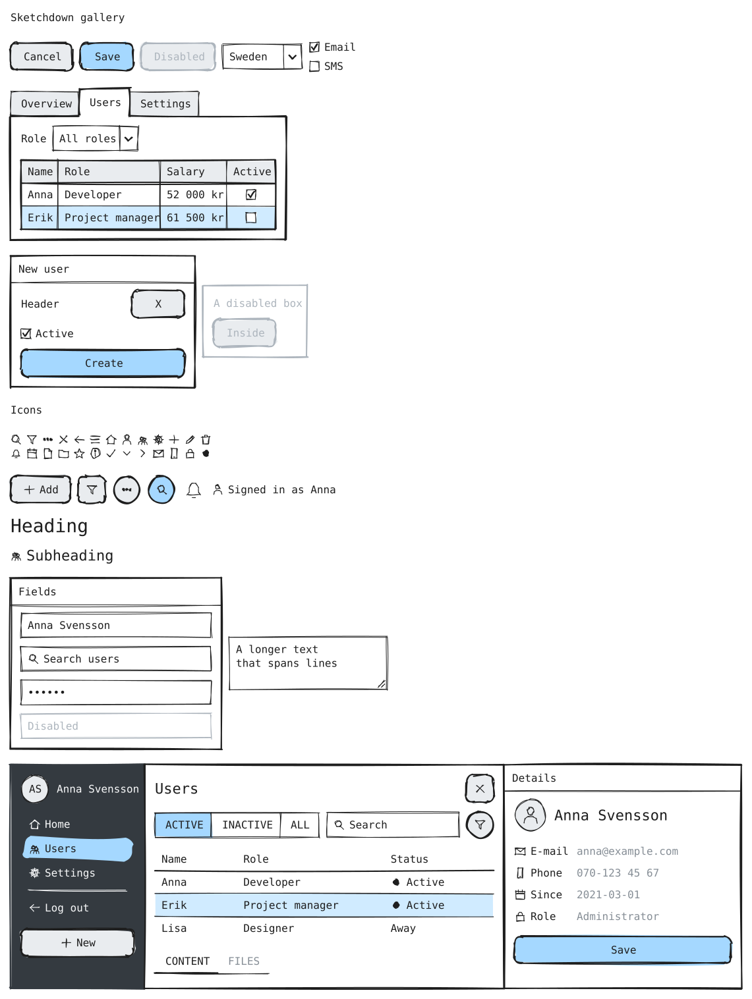
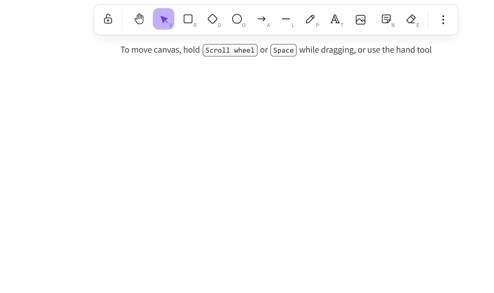
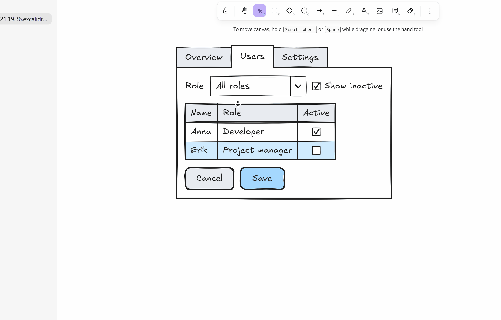
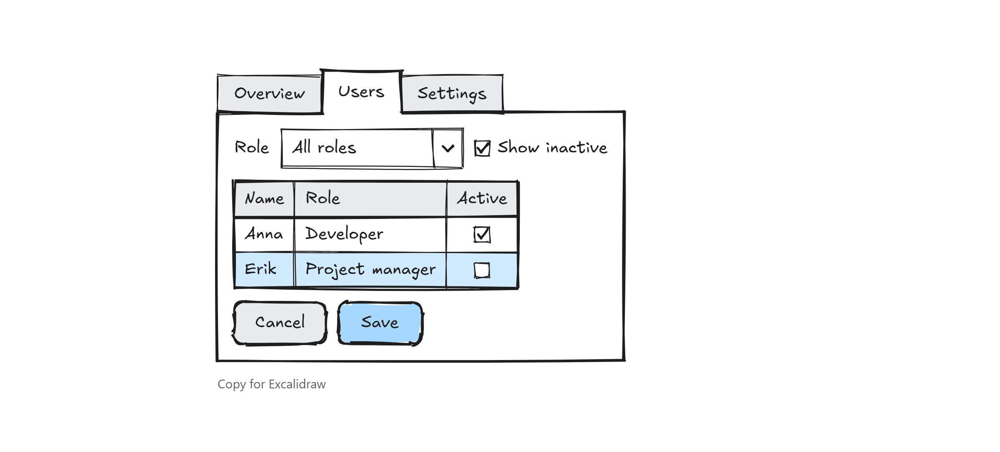

# Sketchdown

Balsamiq-style wireframes for [Excalidraw](https://excalidraw.com) inside
Obsidian. Write a few lines of text and get a hand-drawn screen made of
native Excalidraw elements: rectangles, lines and text you can annotate,
connect with arrows and keep drawing around.

```sketchdown
dialog: Delete user?
  text: Anna Svensson will lose access.
  buttons: Cancel | *Delete
```





## Install

Sketchdown needs the
[Excalidraw plugin](https://github.com/zsviczian/obsidian-excalidraw-plugin)
2.0.0 or newer.

While Sketchdown is in beta, install it with
[BRAT](https://github.com/TfTHacker/obsidian42-brat): run **BRAT: Add a beta
plugin for testing** and enter `magnushaggren/sketchdown`. Then enable Sketchdown
under Community plugins.

## Use

### In a drawing

- **Paste a spec** onto the canvas. A ```` ```sketchdown ```` code block is
  always drawn; plain text is drawn when it is a valid spec (a setting).
  Ctrl/Cmd+Shift+V pastes plain text instead.
- **Sketchdown: Create or edit wireframe** opens an editor with a live
  preview:
  - with a wireframe selected, it edits that wireframe and redraws it in
    place;
  - with a single text element selected, it turns the text into a wireframe;
  - with nothing selected, it starts a new one.
- **Edit wireframe**, a button above a selected wireframe, does the same.



- **Sketchdown: Insert component** opens the editor on a palette of
  snippets, from a single button to a whole app screen.

### In a note

A ```` ```sketchdown ```` code block is drawn as a wireframe in reading view
and live preview. **Copy for Excalidraw** under it copies the block for
pasting into a drawing, and **Sketchdown: Send wireframe to Excalidraw**,
with the cursor in the block, draws it in the drawing you used last.



### The text is the truth

A wireframe is a group of ordinary Excalidraw elements that remembers its
spec. Editing the spec redraws the whole group, so changes made by hand
inside the group are lost on the next edit. Annotations, arrows and shapes
outside the group are not touched.

## Syntax

One component per line, `keyword: content (options)`. Indentation nests
components inside containers such as `box`, `row`, `tabs` and `dialog`. `*`
marks the selected or primary item, `|` separates items, `{icon}` draws an
icon, `[text]` a link and `-text-` grey text. The full reference is
[docs/SYNTAX.md](docs/SYNTAX.md).

<!-- cheatsheet:start (generated from docs/SYNTAX.md by npm run cheatsheet) -->

| Keyword (aliases) | Example |
|---|---|
| `button` (btn) | `button: *Save` |
| `dropdown` (select, combo, combobox) | `dropdown: *Sweden \| Norway` |
| `checkbox` (check, checkboxes) | `checkbox: [x] Email \| [ ] SMS` |
| `text` (label) | `text: Role` |
| `grid` (table, datagrid) | `grid`, then rows like `Anna, Developer` |
| `tabs` (tab) | `tabs: A \| *B \| C` |
| `box` (panel, group) | `box: New user` |
| `row` | `row:` |
| `icon` | `icon: search` |
| `input` (field, textbox) | `input: Anna` |
| `search` | `search: Find users` |
| `password` | `password: secret` |
| `textarea` | `textarea: Notes` |
| `h1` (heading) | `h1: Users` |
| `h2` (subheading) | `h2: Details` |
| `columns` (cols) | `columns: (w=1200, h=700)` |
| `nav` (navigation) | `nav: {home} Home \| *{users} Users \| - \| Log out` |
| `avatar` | `avatar: AS` |
| `details` (properties) | `details: {phone} Phone \| 070-123` |
| `window` | `window: Settings` |
| `dialog` (modal) | `dialog: Delete user?` |
| `browser` | `browser: My app \| example.com` |
| `phone` | `phone: Users` |
| `buttons` | `buttons: Cancel \| *OK` |
| `link` | `link: Forgot password?` |
| `paragraph` (p, lorem) | `paragraph: lorem (lines=4)` |
| `radio` (radios, option) | `radio: Small \| *Medium \| Large` |
| `toggle` (switch) | `toggle: [on] Wi-Fi \| [off] Bluetooth` |
| `slider` (range) | `slider: 40%` |
| `alert` (message, notice) | `alert: {info} Saved! [Undo]` |
| `progress` | `progress: Uploading 60%` |
| `tooltip` (hint) | `tooltip: Copied!` |
| `image` (img, picture) | `image: 320x180 Team photo` |
| `breadcrumb` (breadcrumbs, crumbs) | `breadcrumb: Home > Users > Anna` |
| `pagination` (pager, pages) | `pagination: < 1 *2 3 … 10 >` |
| `menu` (contextmenu) | `menu: Copy \| Ctrl+C` |
| `tree` | `tree: Project` |
| `placeholder` | `placeholder: 240x40 Date picker` |

<!-- cheatsheet:end -->

## Screenshot to wireframe

The [screenshot-to-sketchdown](skills/screenshot-to-sketchdown/SKILL.md)
skill teaches an AI agent such as Claude to turn a screenshot of a UI into a
Sketchdown spec. Parts it can't draw become sized `placeholder` boxes, and it
reports which components are missing. It checks its own work with a bundled
script that renders the spec (Node, plus Chrome or Edge for images).

- Claude Code: copy the `skills/screenshot-to-sketchdown` folder to
  `~/.claude/skills/`.
- Claude apps: zip the folder and upload it under Settings → Capabilities.

Then share a screenshot and ask for a Sketchdown wireframe. Paste the result
into a drawing.

## Settings

- **Colours** of fills, primary buttons, selections, links, dark panels and
  more.
- **Font size and gaps** between and inside components.
- **Pasting**: whether plain text that is a valid spec becomes a wireframe.
- **Notes**: whether code blocks are drawn.
- **Stroke and font**: take the stroke colour, font and sloppiness from the
  drawing, or use a fixed style. Notes always use the fixed style.

## Develop

- `npm run dev`: watch build to `main.js`
- `npm run build`: type-check and production build
- `npm test`: run the tests
- `npm run sketch -- spec.txt out.svg out.png`: check a spec and render it
  outside Obsidian
- `npm run skill`: regenerate the skill's syntax reference and checker
- `npm run cheatsheet`: regenerate the cheat sheet above from
  `docs/SYNTAX.md`

## Credits

- Inspired by [Balsamiq](https://balsamiq.com).
- Syntax ideas from [Wireframy](https://github.com/divyaraj-m/wireframy)
  (MIT), which also has an Obsidian plugin that renders wireframes in notes.
- Built on [Excalidraw](https://excalidraw.com) and the
  [Obsidian Excalidraw plugin](https://github.com/zsviczian/obsidian-excalidraw-plugin)
  by Zsolt Viczián.
- Hand-drawn rendering in notes by [Rough.js](https://roughjs.com).

Licence: [MIT](LICENSE).
